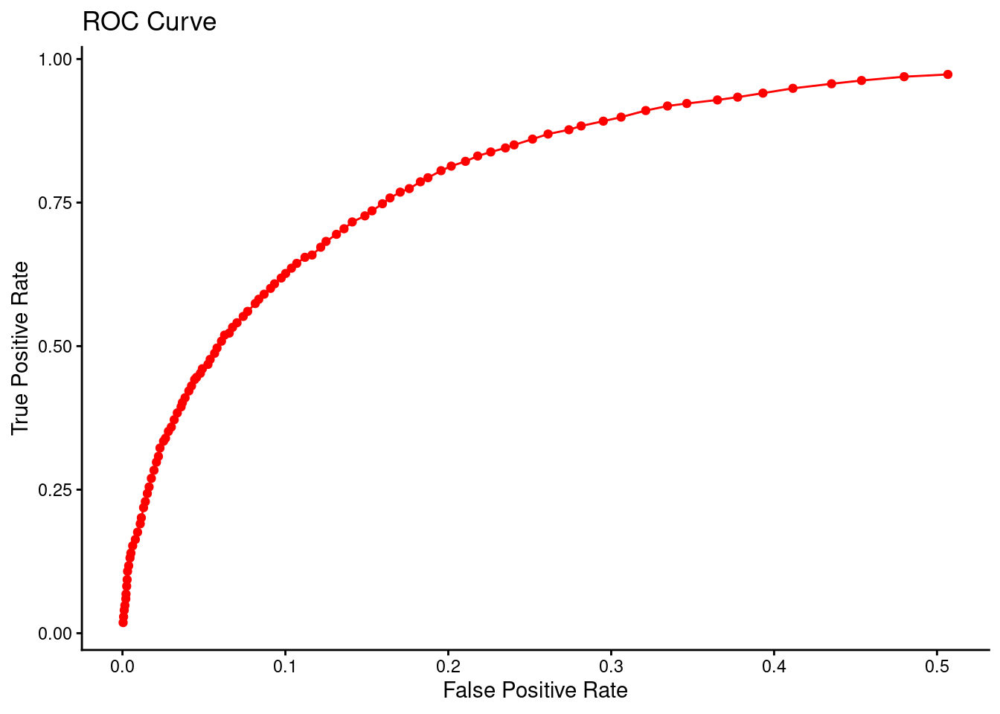
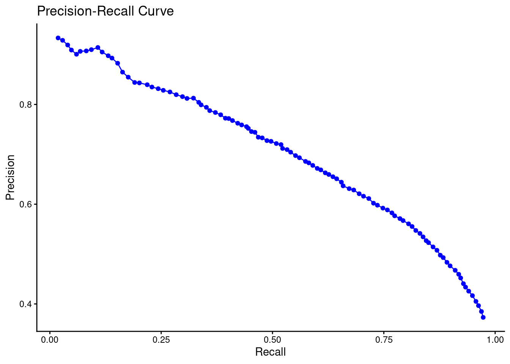

# m6APrediction

An R package for predicting RNA N6-methyladenosine (m6A) sites using the
pre-trained random forest from the BIO215 practical. It provides batch and
single-site prediction from genomic features and five-base DNA sequences.

## Installation

Requires R >= 3.5.0 and randomForest.

Install from GitHub

```r
install.packages("remotes")
remotes::install_github("djtcjs/m6APrediction")
```

Alternatively, install the source archive from its download directory:

```r
install.packages("randomForest")
install.packages("m6APrediction_1.0.0.tar.gz", repos = NULL, type = "source")
```

## Usage

The model and example input are included in the installed package.

```r
library(m6APrediction)
ml_fit <- readRDS(system.file("extdata", "rf_fit.rds", package = "m6APrediction"))
example_df <- read.csv(system.file("extdata", "m6A_input_example.csv",
                                  package = "m6APrediction"))

# Predict multiple sites.
batch_result <- prediction_multiple(ml_fit, example_df, positive_threshold = 0.5)
head(batch_result)

# Predict one site using the example in the Practical 6 documentation.
prediction_single(
  ml_fit,
  gc_content = 0.6,
  RNA_type = "mRNA",
  RNA_region = "CDS",
  exon_length = 12,
  distance_to_junction = 5,
  evolutionary_conservation = 0.8,
  DNA_5mer = "GGACA",
  positive_threshold = 0.5
)
```

## Model performance

ROC and precision-recall curves from the Practical 3 assignment.



